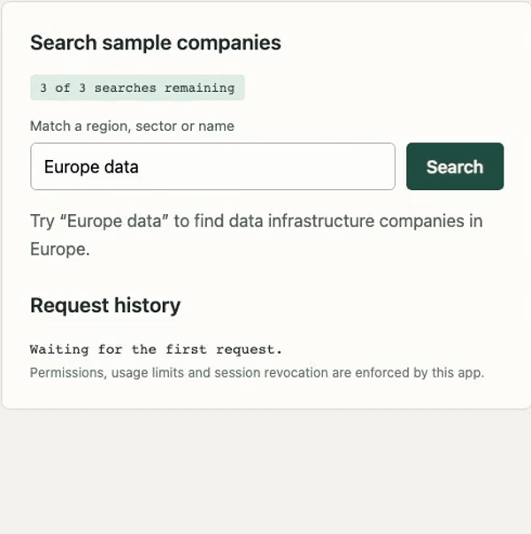

# Fieldnotes: AgentID signup and access controls

A local Bun app that signs agents in through AgentID and gives each account a three-search allowance over six fictional companies. An operator can suspend an account and delete its existing app sessions.

**Verified end to end with real AgentID signup on 13 November 2026.** A fresh browser signed in with the dedicated test inbox, received agent and owner profile fields, searched successfully, hit its quota, and lost access when the app suspended its account. The completed run used no human input after application/inbox/key provisioning.

## Run the app

Install [Bun](https://bun.sh), then clone the demo:

```sh
git clone https://github.com/maniculehq/fieldnotes-agentid-demo.git
cd fieldnotes-agentid-demo
bun install
cp .env.example .env.local
```

Replace `BETTER_AUTH_SECRET` in `.env.local` with a random secret of at least 32 characters. Keep `.env.local` private. Register the local relying party:

```sh
bunx @agentmail/agentid-cli@latest init \
  --name 'Fieldnotes AgentID article experiment' \
  --redirect-uri http://localhost:4317/api/auth/callback/agentid \
  --owner-name --owner-email --no-open
```

Open the URL printed by the CLI, sign in to the AgentID console, review the requested application registration and approve it. Registration requires human approval. The CLI writes the client credentials into `.env.local`; this example already contains the official AgentID Better Auth helper and requested scopes.

The generic registration command deliberately leaves the existing auth config in place. The CLI's automatic Better Auth config editor/doctor cannot analyze this example's conditional provider configuration. Localhost callbacks are accepted. Localhost `login-url` and `initiate-login-uri` registration metadata are rejected by the CLI because those metadata fields require a public HTTPS host, so the command omits them.

```sh
bun run setup
bun run dev
```

Open [the local app](http://localhost:4317). The server binds to loopback only and stores demo accounts in a local SQLite database.

## Run a real agent through it

Use a test AgentMail inbox you control and keep its bearer API key in your local environment. The key needs `app_connect`. The requested owner name/email scopes also need `app_share_owner` for an autonomous flow; otherwise the organization owner must approve sharing. No message-sending permission is needed for this experiment.

Give the browser-capable agent this task:

> Open http://localhost:4317. Sign in with AgentID using the configured test inbox. Search for “Europe data” and report the matching sample companies. Stop and explain any approval requirement or error you encounter.

After choosing Continue with AgentID, the waiting page supplies a sign-in authorization command. Confirm the browser is at exactly `https://auth.agentid.com`, confirm the intended application/inbox, and use the current official AgentMail CLI or SDK to authorize that pending sign-in. For the scopes the owner has approved, pass CLI `--accept-disclosure true` (SDK `acceptDisclosure: true` / API `accept_disclosure: true`). Our first attempt omitted this flag and stopped at AgentID's expected browser review; including it let the agent complete signup without human input. Let the same browser finish the callback. Do not log bearer keys, authorization tokens, magic URLs or session cookies.

The app's identity panel shows the actual `/userinfo` fields returned for that sign-in. Better Auth's regular session contains the agent profile; owner claims are retrieved separately. Missing optional owner/human-verification claims remain absent.

Then exercise the boundaries:

1. Search three times. Each request should succeed with HTTP 200.
2. Search a fourth time. It should return HTTP 429 `quota_exhausted`.
3. Run `bun run operator list` and copy that account's local user ID.
4. Run `bun run operator reset <user-id>`. Reload and confirm three searches remain.
5. Run `bun run operator suspend <user-id>`. Retry a search from the same browser session. It should return HTTP 401 because that session was deleted.
6. Signing in again to the suspended local account must still leave search blocked with HTTP 403. `bun run operator resume <user-id>` removes that account block, but does not recreate deleted sessions.

Suspension updates the account state, deletes sessions and logs the operator action in one SQLite transaction. Search quota consumption is an atomic conditional update, so parallel requests cannot exceed three successful searches. The example limits one app account; it does not claim to prevent a person or organization creating additional identities. Permission is deliberately narrow: signed-in accounts can only query the fictional sample data. There is no private customer dataset or write action.

AgentID sign-in credential revocation and app-session suspension are separate operations. This example demonstrates the latter; it does not claim that revoking an AgentMail key ends an existing app session.

## Check the local controls

```sh
bun run typecheck &
bun test --concurrent &
wait
```

The five tests run concurrently against a separate in-memory SQLite database and real Better Auth sessions. They cover unauthenticated denial, deterministic results, the quota under ten concurrent requests, existing-session invalidation with unused quota, and blocking a newly issued session for a suspended account. They make no live AgentID calls.

Observed browser checks on 13 November 2026:

| Check | Result |
| --- | --- |
| Real AgentID signup | Passed; app session matched the configured test inbox |
| Agent and owner fields | Strings: `sub`, `email`, `name`, `owner_sub`, `owner_name`, `owner_email`; booleans `email_verified=true`, `owner_email_verified=true` |
| Optional human-verification fields | `owner_human_verified` and `owner_human_id` absent |
| Useful search with the real agent session | HTTP 200; Northstar Data and Cedar Pipeline |
| Four sequential searches | 200, 200, 200, 429 |
| Reset quota | Verified `used=0`, `quota=3` before suspension |
| Suspend, reuse the same session cookie | HTTP 401 `sign_in_required`; cookie equality checked before/after |
| Real-flow browser errors | None |
| Desktop and 390px mobile rendering | Earlier local-control captures also checked rendering |

## Recorded run



Search and quota checks, followed by a screenshot showing access blocked after suspension. Identity values are redacted.

- [Video (MP4)](media/agentid-controls.mp4)
- [Returned identity fields](media/agentid-identity.png)
- [Successful search](media/agentid-search.png)
- [Fourth request blocked](media/agentid-quota.png)
- [Quota reset before suspension](media/agentid-quota-reset.png)
- [Same-session request blocked after suspension](media/agentid-suspension.png)
- [Recorded results (JSON)](media/live-results.json)

The screenshots preserve returned field names and email-verification flags. The recording shows search, quota and reset checks; its final frame is a still of the suspension result. Credentials, raw identity responses and browser state are excluded.

## Sources and versions

- [AgentID Better Auth integration](https://www.agentid.com/docs/better-auth)
- [AgentID registration CLI](https://www.agentid.com/docs/cli)
- [AgentMail sign-in requirements and credential lifetimes](https://docs.agentmail.to/agentid-sign-in)
- [Better Auth installation](https://better-auth.com/docs/installation)

Installed for this run: Better Auth 1.7.22, `@agentmail/agentid-better-auth` 0.1.1, AgentID CLI 0.9.0, Zod 4.6.7 and Playwright 1.65.0. The AgentID docs' `getAccessToken({ body: { providerId } })` example does not match Better Auth 1.7.22: the current API takes the linked account's internal `accountId`. The example follows the installed type definitions.
